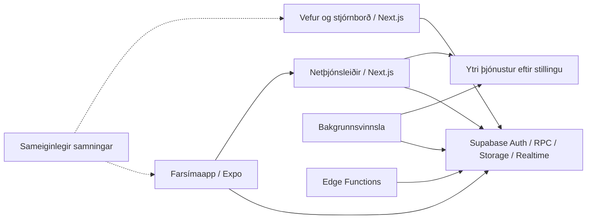

# Hittumst — afhending til tæknilegrar yfirferðar

Dagsetning: **3. nóvember 2026**. Verkefnisútgáfa: **0.1.0**.

Þetta skjal er inngangur fyrir þann sem fær verkefnið til yfirferðar. Það lýsir kóðanum sem fylgir þessari afhendingu, tengir við ítarlegri skjöl og aðgreinir útfærslu frá staðfestri virkni í rekstri. Prófunarniðurstöður þessarar afhendingar eru í [prófunaskýrslunni](YFIRFERD-PROFANIR-2026-11-03.md).

## 1. Hvað er verið að byggja?

Hittumst er íslenskt, tvítyngt samfélags- og stefnumótaforrit fyrir 18 ára og eldri í LGBTQ+ samfélaginu. Það sameinar prófíla og leit, einkaspjall, vini og hópa, Hittinga og samfélagsefni. Íslenska er sjálfgefið viðmót og enska fylgir með.

Verkefnið er umfangsmikil forútgáfa. Kóði fyrir marga eiginleika er til staðar, en það jafngildir ekki fullprófaðri framleiðsluútgáfu. Sýnihamur með tilbúnum gögnum, tengdur prófunarhamur og opinber útgáfa hafa ólíkar kröfur. Sérstaklega eru raunverulegar greiðslulausnir, ytri þjónustur, tækjaprófanir og rekstrarviðbúnaður óstaðfest eða ólokið.

Gömul heiti eins og `rummal`, `@rummal/*`, `is.rummal.app` og `rummal`-tenglar koma enn fyrir í pakkaskipan og auðkennum. Þau eru hluti af núverandi tæknilegum samningum, þótt sýnilegt vöruheiti sé Hittumst. Ekki endurnefna þau án þess að skoða byggingar, innskráningu og tengingar.

## 2. Lestrarleið fyrir frænda

1. Þetta skjal og [nýjar prófunarniðurstöður](YFIRFERD-PROFANIR-2026-11-03.md).
2. [Arkitektúr](architecture.md), síðan [farsímaeiginleikar](feature-verification.md) og [vefur/stjórnborð](admin-feature-verification.md).
3. Skoða `apps/mobile/src/services`, `apps/admin/src/lib`, `packages/shared/src` og nýjustu SQL-migrations.
4. [Það sem vantar fyrir útgáfu](left-to-do-before-launch.md) og [útgáfuhlið](launch-readiness.json), með dagsetningafyrirvara hér að neðan.
5. Velja síðan dýpri yfirferð á öryggi, gagnagrunni, miðlum, rekstri eða greiðslum.

Markmiðið með yfirferðinni er að meta hvað sé traust, hvar tækniskuldin liggi og hvaða verk eigi að vinna næst. Ekki þarf að tengjast lifandi þjónustum til að byrja kóðayfirferðina.

## 3. Hvað fylgir afhendingunni?

Allur útgáfustýrður Hittumst-kóði og nýjar Hittumst-skrár: farsímaapp, vefur/stjórnborð, sameiginlegir pakkar, SQL-migrations, gagnagrunnspróf, Edge Functions, smíða- og rekstrarskriftur, CI, hönnunarefni og skjöl. GitHub-sagan er varðveitt, þar á meðal fyrirliggjandi breyting á `main` sem fannst við undirbúning.

Eftirfarandi fylgir ekki: raunverulegar `.env`-skrár og lyklar, `node_modules`, staðbundnir gagnagrunnar, byggingar og APK/IPA, myndskeið eða gögn raunverulegra notenda, vinnumöppur og óhreinsuð prófunargögn. Endurbyggjanlegar skrár og einkagögn eru ekki hluti af frumkóðasafninu. Örugg `.env.example`-sniðmát fylgja með til uppsetningar; þau voru endurheimt úr fyrri Git-útgáfu þar sem nýjasta fjarlæga breytingin hafði fjarlægt þau.

Sjálfstæða námsverkefnið `prototypes/study-learning` (Study Atlas) er með eigin Git-sögu og er **undanþegið samkvæmt ákvörðun eiganda**. Það er ekki hluti af Hittumst.

Repóið var opinbert við þessa afhendingu. Ekki setja lykla, aðgangsupplýsingar, raunveruleg prófílgögn eða óhreinsaða villuskráningu í skjöl, issues eða pull requests.

## 4. Kort af verkefninu

| Slóð | Hlutverk |
| --- | --- |
| `apps/mobile/app` | Skjáir og leiðakerfi Expo Router; m.a. discover, chats, profile, Hittingar, Samfélag og showcases. |
| `apps/mobile/src/components` | Sameiginlegt viðmót, prófílar, spjallviðbætur og aðlögun fyrir stærri skjái. |
| `apps/mobile/src/features` | Hittingar, onboarding, sýningarsöfn, samfélagsveita og Strax. |
| `apps/mobile/src/services` | Sýni- og raunþjónustur, RPC-köll, miðlaupphleðsla, tilkynningar og umhverfisval. |
| `apps/mobile/src/providers` | Innskráning/app-ástand, útlit og spjallástand. |
| `apps/mobile/src/i18n` | Íslenska og enska. |
| `apps/admin/src/app` | Opinber vefur, notendagátt, verndað stjórnborð og netþjónsleiðir. |
| `apps/admin/src/lib` | Aðgangsstýring, moderation, greiðslusamningar, jobs, þjónustur og rekstur. |
| `apps/admin/src/worker.ts` | Samfelld bakgrunnsvinnsla. |
| `packages/shared` | Sameiginleg gagnalíkön, sannprófun, viðskiptareglur og hönnunargildi. |
| `supabase/migrations` | Röðuð SQL-saga gagnagrunnsins. |
| `supabase/tests/database` | SQL-öryggis- og hegðunarpróf, auk samhliða prófunarskrifta. |
| `supabase/functions` | Edge Functions, m.a. push-worker, place-search og strax-media. |
| `scripts` | Byggingar, útgáfuskilyrði, gagnagrunns- og endurheimtaræfingar, rekstur og próf. |
| `.github/workflows` | Sjálfvirkar prófanir og staging-aðgerðir. |
| `design`, `assets` | Figma-innflutningsefni og vörumerkjaefni. |
| `docs` | Tæknileg skjöl, eiginleikalistar, rekstrarhandbækur og útgáfuskilyrði. |

Tæknigrunnur samkvæmt pakkaskrám: Expo 57, React Native 0.86.3, React 19.2.3, Next.js 16, TypeScript og npm-workspaces. Nákvæmar útgáfur eru í `package.json` og `package-lock.json`; pakkar nota ekki allir sömu TypeScript-útgáfu.



Farsímaappið á aðeins að hafa opinbera tengilykla. Leynilyklar og aukin réttindi eiga heima á netþjóni/vinnslu. Endanleg aðgangsstýring þarf að standast í gagnagrunni og miðlageymslu, óháð því hvað viðmótið sýnir.

## 5. Helstu eiginleikar og mörk þeirra

| Svið | Það sem er í kóðanum | Það sem þarf enn að staðfesta |
| --- | --- | --- |
| Innskráning og prófílar | Onboarding, tungumál, prófílbreytingar, útlit, merkingar og aðalmynd. | Raunverulegt OAuth/SMTP, session-lífsferill og hegðun á tækjum. |
| Leit og tengsl | Prófilgrind, síur, vinir, stjörnumerkingar, lokanir og gróf staðsetning. | Persónuvernd, mörk gagnasýnar, staðsetningarheimildir og hegðun við slæma tengingu. |
| Spjall og hópar | Einkaskilaboð, hópar, hópspjall, samtalsstillingar og LiveKit-hóprödd. | Raunveruleg afhending, Realtime, afturköllun aðgangs, hljóð og bakgrunnshegðun. |
| Einkamiðlar | Albúm, heimildir, sóttkví, yfirferð, áfrýjanir og eyðingarferli. | Tengdur miðlaferill, AWS-stillingar, afturköllun tengla og rekstrarbilun. |
| Hittingar | Stofnun/stjórnun, þátttaka, staðsetningarvernd, spjallherbergi, miðlar, svör, kannanir og minningaveggir. | Nýjustu migrations á tengdum grunni, samhliða aðgerðir, kort, push og tækjapróf. |
| Strax | Skammlífar athafnir, prófílmerkingar og miðla-/þjónustusamningar. | Gildistími, aðgangur, hreinsun og samspil allra raunþjónusta. |
| Sýningarsöfn | Söfn á prófílum, sniðmát, drög, áhorfendaval, samþykki og miðlar. | Birtingarmörk, samþykki fólks, albúmheimildir og afturköllun. |
| Samfélag | Samfélög, færslur, athugasemdir, viðbrögð, myndir og stjórnun. | Tengdar heimildir, miðlayfirferð, tilkynningar og stjórnunarferli. |
| Greiðslur og áskriftir | RevenueCat-/verslanasamningar og afstemming; sandbox-veski, færslubók og eldri sjóðasamningar. | Samþykktir framleiðsluaðilar, raunverulegar færslur og fjármögnun skuldbindinga. |
| Stjórnborð | Hlutverk/MFA, tilkynningar, yfirferð, áfrýjanir, audit og rekstrarsýn. | Raunveruleg starfsmannaréttindi, vaktir, viðbrögð og aðgangsúttekt. |
| Útflutningur/eyðing | Notendagátt, eyðingarvinnsla, þjónustueyðing og eyðingarmeðvituð endurheimt. | Heildarferli með þjónustuaðilum, geymslu og staðfestri endurheimt. |

Þetta er yfirlit yfir útfærslu, ekki samþykkisvottorð fyrir eiginleikana. Nákvæm notkunartilvik eru í [eiginleikalistanum](feature-verification.md).

### Nýlegar breytingar sem skipta yfirferðina máli

Afhendingin inniheldur vinnu frá október sem var ekki öll komin á GitHub: minningaveggi, prófílútlit/GIF, tilkynningastillingar, Hittinga-spjall í innhólfi, sýningarsöfn, Strax, miðla og kannanir í herbergjum, samfélagsveitu, eina opinbera aðalmynd og beina þátttökugreiðslu til gestgjafa.

Nýjasti eiginleikalistinn, frá 14. október, segir að Sjóður og sponsorship-stýringar hafi verið fjarlægðar úr Hittinga- og veskisviðmóti. Eldri samningar, próf og færslugögn eru áfram í bakenda. Þessi afmörkun útskýrir af hverju sjóðakóði finnst enn. Bein gjöld til gestgjafa eru sérstök lýsing á greiðslu beint til gestgjafa og sanna ekki samþætt framleiðslugreiðslukerfi.

Sýnihamur og raunhamur hafa aðskilda þjónustuflokka. Skoða þarf báða: að aðgerð virki á tilbúnum gögnum sannar ekki að RPC, heimildir eða bakgrunnsvinnsla styðji sama ferli.

## 6. Hvernig á að keyra verkefnið?

### Forsendur

- Node.js að lágmarki 22.9.0; CI notar Node 24.
- npm **11.19.1**, eins og rótarpakkinn tilgreinir. Ekki láta eldri npm endurskrifa lockfile að óathuguðu máli.
- Fyrir staðbundinn tengdan bakenda: Docker og Supabase CLI **2.117.0** samkvæmt núverandi CI/README.
- Fyrir native-próf: viðeigandi Android/iOS-smíðaverkfæri eða EAS-aðgangur. iOS-smíði krefst viðeigandi macOS/EAS-umhverfis.

Úr nýju klóni, við rót repósins:

```powershell
git clone https://github.com/Frikks1/Hittumst.git
cd Hittumst
npx --yes npm@11.19.1 ci
```

Uppsetning keyrir `patch-package` og dependency-próf. Lesa [dependency-security.md](dependency-security.md) áður en patchar eða útgáfuþvinganir eru fjarlægðar.

### Skoða viðmótið með tilbúnum gögnum

Ekki þarf lifandi gagnagrunn til að byrja. Í development verður farsímaappið sýnihamur þegar opinberar Supabase-breytur vantar. Ekki afrita placeholder-URL og placeholder-lykil inn sem virka tengingu; ófullkomnar stillingar gefa stillingarvillu.

```powershell
npm run web --workspace @rummal/mobile
npm run dev --workspace @rummal/admin -- --port 3001
```

Keyra í tveimur gluggum. Síðari skipunin setur stjórnborð/vef á port 3001. Fyrir Expo native-þróun er einnig `npm run dev:mobile`. Native-viðbætur geta krafist development-builds; vafraprófun staðfestir ekki push, innkaup eða rödd á síma.

Ekki nota fyrirliggjandi staðbundnar `.env.local`-skrár frá eiganda. Þær fylgja ekki GitHub og geta tengst raunverulegu umhverfi. Sýnihamur er ekki sjálfgefinn varahamur í staging/production.

### Tengdur staðbundinn bakendi

```powershell
npm run db:start
npm run db:reset
```

`db:reset` endurstofnar staðbundin gögn. Nota aðeins eigin staðbundinn prófunargrunn. Fyrir farsímaappið: afrita sniðmátið í `.env.local` og setja eigin staðbundnar tengistillingar. **Þekkt takmörkun:** `apps/admin/src/lib/env.ts` samþykkir nú aðeins HTTPS `*.supabase.co` og hafnar localhost-Supabase. Stjórnborðið getur því keyrt í sýniham eða tengst eigin aðskildum hýstum prófunargrunni; bein localhost-tenging þess krefst verkfræðilegrar breytingar og prófana. Staðbundinn grunnur nýtist farsímaappinu og CLI-gagnagrunnsprófum. Farsímaappið samþykkir publishable-lykil, ekki service-role/JWT-lykil; staðfesta þarf að staðbundna umhverfið útvegi rétt lykilsnið. Gervigögn eru í `supabase/seed.sql`.

Yfirfara [database-reconciliation.md](database-reconciliation.md) áður en nokkur migration er keyrð á fyrirliggjandi hýstan grunn. Ekki nota reset á hýst gögn. [functions README](../supabase/functions/README.md) lýsir Edge Functions og aðskildum stillingum þeirra.

## 7. Prófanir og byggingar

```powershell
npm run typecheck
npm test
npm run test:release
npm run test:dependencies
npm run lint
npm run build
```

`npm run check` sameinar fyrstu fimm. `npm run build` byggir workspace-pakka sem hafa build-skriftu; það er ekki native Android/iOS-útgáfa og farsíma-web-export er sér:

```powershell
npm run build:web --workspace @rummal/mobile -- --output-dir dist-review
```

Fyrir eigin staðbundinn bakenda eru einnig `npm run db:test`, `npm run test:services` og `npm run recovery:local`. Síðustu tvö framkvæma skrif/æfingar í prófunarumhverfi; lesa skriftur og stillingarskilyrði áður en þau eru keyrð. Ekki benda þeim á hýstan grunn eiganda.

CI í `.github/workflows/ci.yml` inniheldur app-próf, admin-build/HTTP-athuganir, mobile-web-export, Edge-athuganir, hreina og uppfærða gagnagrunnsuppsetningu, staðbundna þjónustuferla, endurheimt og Docker-runtime. Edge-jobið nefnir sérstaklega push-worker og place-search; yfirfara þarf þekju nýrra Edge Functions eins og strax-media. Staging-workflow er sérstök rekstraraðgerð.

`release:preflight` er útgáfuvörn og má eiga að falla meðan hlið/stillingar/sannanir vantar. Ekki breyta readiness-gögnum í passed til þess eins að fá græna keyrslu.

## 8. Gagnagrunnur og raunveruleg staða hýsingar

Afhendingarkóðinn inniheldur **61 SQL-migration** og **55 SQL-prófunarskrár**. Nýjasta migration er `20261014174335_meetup_host_direct_fees.sql`.

Eldri staðaskjöl skrá staging með **43 migrations í lok september**. Ekki var farið inn á hýstan Supabase eða Render í þessari afhendingu til að staðfesta breytingar síðan. Munurinn á 43 og 61 er því yfirferðarverkefni, ekki fullyrðing um bilun eða staðfesta uppfærslu. Bera þarf saman migration-sögu, schema og generated types áður en nýjustu eiginleikar eru prófaðir tengdir.

Render-, AWS-, Docker- og EAS-stillingar eru frumkóði fyrir innviði. Að þær séu til staðar sannar ekki að innviðir séu rétt settir upp eða rekstrarhæfir. Ekki voru keyrðar hýstar migrations, endurræsingar, greiddar innviðabreytingar eða verslanasendingar við undirbúning þessa pakka.

### Gömul stöðuskjöl þarf að lesa með dagsetningu

- `implementation-status.md` lýsir stöðu 21. september.
- `START-HERE.md`, `external-launch-blockers.md` og hlutar `launch-readiness.json` vísa til lok september.
- `feature-verification.md` nær til nýrri októbervinnu.
- Niðurstöður dagsins eru í sérstöku fylgiskjali og leysa ekki af hólmi device/provider-próf.
- Sum eldri skjöl vísa í `artifacts/` og `tmp/`. Þær möppur eru útilokaðar úr Git; ekki reikna með að eldri hráar sannanir fylgi klóni. Birta aðeins hreinsaðar niðurstöður eða endurkeyra viðeigandi próf.

## 9. Hvað er ólokið fyrir almenna útgáfu?

1. **Greiðslur:** Framleiðslusamþykki og samþættingar fyrir innheimtu, auðkenningu/KYC, útgreiðslur, inneignir/voucher, endurgreiðslur og afstemmingar. `SandboxProvider` er enn notaður í commerce-vinnslu. `purchaseReadiness('PRODUCTION')` lokar kaupum með `financial_provider_approval_required` í `apps/admin/src/lib/billing/server.ts`.
2. **Þjónustutengingar:** Staðfest SMTP/OAuth, kort/geocoding, miðlayfirferð, push, LiveKit og RevenueCat/verslanir í aðskildum umhverfum.
3. **Tækjapróf:** Undirritaðar útgáfur á Android/iPhone og viðeigandi spjaldtölvum; heimildir, afturköllun, bakgrunnur, rödd, tilkynningar, kaup, miðlar og aðgengi.
4. **Öryggi/persónuvernd:** RLS/heimildir, viðkvæm gögn, lágmörkun staðsetningar og greiningargagna, eyðing og endurheimt, samþykkt varðveisla og viðeigandi persónuverndarmat.
5. **Rekstur:** Nafngreindur rekstraraðili, lén, þjónustu-/öryggistengiliðir, varamaður, vöktun, viðbragðsæfingar, afritun og endurheimt.
6. **Álag og útgáfa:** Tengd álags-/endurheimtarpróf, nýjar sannreynanlegar niðurstöður, verslanagögn og raunverulegt samþykki verslana.

Þetta er staða samkvæmt kóða og fyrirliggjandi skráningu. Ekki hefur verið staðfest hvort eigandi hafi lokið einhverjum ytri skrefum síðan síðasta dagsetta skjal var skrifað. [Útgáfuhliðin](launch-readiness.json) eru áfram pending/blocked í þessari afhendingu.

## 10. Tillaga að tæknilegri yfirferð

| Forgangur | Athugun | Gagnleg niðurstaða |
| --- | --- | --- |
| 1 | Klóna, setja upp og endurkeyra athuganir á nákvæmu commit. | Endurtakanleg uppsetning og listi yfir raunverulegar villur. |
| 2 | Yfirfara 61 migrations, hreina uppsetningu og varðveitta uppfærslu; bera saman RPC og generated types. | Staðfest samræmi milli appa og gagnagrunns. |
| 3 | Prófa aðgang annarra notenda, brottfall hópa, lokanir og session-afturköllun. | Neikvæð heimildapróf, sérstaklega fyrir staðsetningu, sýningarsöfn, spjall og miðla. |
| 4 | Yfirfara miðlasamninga, sóttkví, tengla, TTL, moderation, eyðingu og endurheimt. | Enginn aðgangur að óleyfðum eða eyddum miðlum; skilgreind bilunarhegðun. |
| 5 | Skoða samhliða aðgerðir, endurteknar beiðnir, worker-leases og hrun í miðju verki. | Engar tvíteknar færslur eða glötuð/óleyfileg aðgerð. |
| 6 | Bera saman sýni- og raunþjónustur, sérstaklega nýju októbereiginleikana. | Skýr mörk þess sem er eingöngu sýnd hegðun. |
| 7 | Meta stórar skrár, þjónustulag, ástandsstýringu, útgáfuþvinganir og viðhald. | Stuttur listi yfir forgangsraðaða tækniskuld. |
| 8 | Skoða framleiðsluflögg og stöðvun kaupa/greiningargagna. | Ófullbúnir eiginleikar opnast ekki við einfalda stillingarbreytingu. |

Skrá gjarnan hverja athugasemd með slóð, endurtekningarskrefum, áhrifum og tillögu. Aðgreina útgáfustöðvandi villur frá viðhaldsbótum. Öryggisgallar með raunverulegum aðgangsupplýsingum eiga ekki í opinber issues.

## 11. Ítarlegri fylgiskjöl

| Efni | Skjöl |
| --- | --- |
| Heildarmynd | [architecture](architecture.md), [feature-verification](feature-verification.md), [admin-feature-verification](admin-feature-verification.md) |
| Næstu útgáfuskref | [left-to-do-before-launch](left-to-do-before-launch.md), [release-checklist](release-checklist.md), [launch-readiness](launch-readiness.json) |
| Gagnagrunnur | [database-reconciliation](database-reconciliation.md), [backend-launch-work](backend-launch-work.md) |
| Miðlar og rekstur | [render-deployment](render-deployment.md), [release-operations-work](release-operations-work.md), [operator-handbook](operator-handbook.md) |
| Persónuvernd og öryggi | [privacy-checklist](privacy-checklist.md), [native-diagnostics](native-diagnostics.md), [moderation-runbook](moderation-runbook.md), [SECURITY](../SECURITY.md) |
| Hittingar og sýningarsöfn | [hittingar-launch-gates](hittingar-launch-gates.md), [profile-showcases](profile-showcases.md), [hittingar-sponsorships](hittingar-sponsorships.md) |
| Greiðslur og áskriftir | [provider-acceptance-packet](provider-acceptance-packet.md), [billing-launch-work](billing-launch-work.md), [commerce-launch-ledger](commerce-launch-ledger.json) |
| Android/verslanir | [android-testing](android-testing.md), [google-play-launch](google-play-launch.md), [store-submission-guide](store-submission-guide.md) |
| Framlag í kóða | [CONTRIBUTING](../CONTRIBUTING.md), [dependency-security](dependency-security.md) |

GitHub er afhending frumkóðans. Aðgangur að lifandi þjónustum, lyklar, viðskiptasamningar og einkagögn eru aðskilin og þarf aðeins að veita ef tiltekið yfirferðarverkefni krefst þess.
